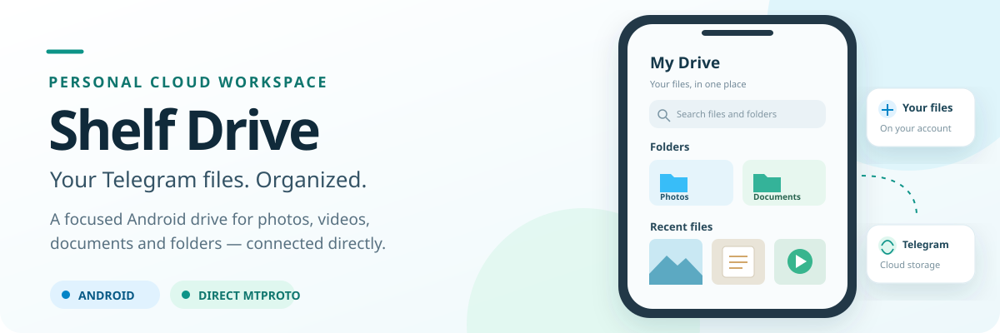

<a href="https://github.com/hellocloudwebdev/shelf-drive-mobile/releases/latest"><strong>Download for Android</strong></a> · <a href="https://hellocloudwebdev.github.io/shelf-drive-mobile/">Project website</a> · <a href="https://github.com/hellocloudwebdev/shelf-drive-mobile/issues">Report an issue</a> · <a href="https://github.com/hellocloudwebdev/shelf-drive">Desktop repository</a>

<a href="#overview">Overview</a> · <a href="#showcase">Showcase</a> · <a href="#features">Features</a> · <a href="#screenshots">Screenshots</a> · <a href="#privacy">Privacy</a> · <a href="#architecture">Architecture</a> · <a href="#build">Build</a>

---

> [!NOTE]
> **This repository builds the Android app** for phones, tablets, foldables, Android TV and Google TV. The desktop app lives in [hellocloudwebdev/shelf-drive](https://github.com/hellocloudwebdev/shelf-drive). Shared application-core paths are maintained according to [Docs/SHARED_CORE_SYNC.md](./Docs/SHARED_CORE_SYNC.md).

> [!IMPORTANT]
> **Android support:** minimum Android version is Android 12 (API 31); the app targets Android 16 (API 36).

## Overview

Shelf Drive turns the files in your Telegram account into an organized, touch-first cloud workspace.

Use **Saved Messages** as your personal file space and create **private Telegram channel-backed folders** to organize content. Shelf Drive adds a familiar drive experience around that storage: browse, search, preview, stream, transfer and optionally encrypt files from one Android app.

- Your device connects directly to Telegram using MTProto.
- File indexes, app settings and working state are managed locally.
- No separate Shelf Drive relay or storage server is required.
- Optional TDENC2 encryption adds a client-side encryption layer for supported workflows.

## Showcase

Animated interface showcase captured from the mobile app. <a href="./assets/readme/showcase.mp4">Watch the MP4 version</a>.

<a href="./assets/readme/tour-feature.mp4">Open the full onboarding walkthrough (MP4)</a>

## Features

| Area | What you can do |
|---|---|
| **File workspace** | Browse folders and files in grid or list layouts, search, sort, select multiple items and manage file actions. |
| **Telegram-backed folders** | Organize files with private Telegram channel-backed folders; use Saved Messages as your personal root file space. |
| **Background transfers** | Upload and download through Android background work, with queue management and supported pause, resume and retry flows. |
| **Media playback** | Preview and stream supported video and audio formats in the app, with playback controls and resume support. |
| **Photos and documents** | Browse photo collections, video libraries and document views; open PDFs and inspect supported archives. |
| **Folder synchronization** | Synchronize selected local Android folders with Telegram-backed folders. See the [Folder Sync Guide](./SYNC_GUIDE.md). |
| **Optional file encryption** | TDENC2 uses XChaCha20-Poly1305 and Argon2id for client-side envelope encryption in supported workflows. |
| **Offline access** | Pin supported files and folders for local access when connectivity is unavailable. |
| **Themes and languages** | Multiple interface themes and 24 locale dictionaries, including RTL language support. |
| **TV navigation** | Large-screen layouts and remote-friendly focus navigation for Android TV and Google TV. |

## Screenshots

<strong>Home</strong>  &nbsp; 

<strong>Photos and folders</strong>  &nbsp; 

<strong>Documents and settings</strong>  &nbsp; 

## Privacy

Shelf Drive is designed around direct account access and local application state.

- **Direct Telegram connection:** file operations use Telegram's MTProto protocol; Shelf Drive does not operate a separate file relay or storage service.
- **Local application data:** settings, indexes, transfer state, caches and vault material are stored in app-controlled device storage.
- **Optional TDENC2 encryption:** supported files can receive an additional client-side encryption layer using XChaCha20-Poly1305 with Argon2id key derivation.
- **No advertising or behavioral analytics:** the app does not include third-party ad SDKs or behavioral analytics libraries.
- **Crash reporting and diagnostics:** crash reporting is enabled by default and can be disabled in Settings. Diagnostic logs and native traces are kept locally; they are not automatically attached to GitHub reports. Review and explicitly export or share diagnostic material before submitting it.

Read the full [Privacy Policy](./PRIVACY.md) and [Security Policy](./SECURITY.md) before relying on the app for sensitive data. Security issues should be reported privately using the process in [SECURITY.md](./SECURITY.md).

## Architecture

| Layer | Technologies | Responsibility |
|---|---|---|
| **Android interface** | React 19, TypeScript, Tailwind CSS, Framer Motion | Mobile screens, navigation, previews and user interactions |
| **Native application shell** | Tauri 2, Android WebView, JNI | Android integration and frontend-to-native communication |
| **Native core** | Rust, Tokio, SQLite | File operations, local indexing, transfers and streaming |
| **Telegram connectivity** | Grammers, MTProto | Authentication and direct Telegram account operations |
| **Encryption** | XChaCha20-Poly1305, Argon2id | Optional TDENC2 client-side encryption |

The Android repository shares selected core paths with the desktop project. Platform-specific behavior is gated and synchronized according to [Docs/SHARED_CORE_SYNC.md](./Docs/SHARED_CORE_SYNC.md) and [Docs/ARCHITECTURE_FREEZE.md](./Docs/ARCHITECTURE_FREEZE.md).

## Get started

### Install

1. Open [GitHub Releases](https://github.com/hellocloudwebdev/shelf-drive-mobile/releases/latest).
2. Download the APK asset for the latest release.
3. Install it on an Android 12+ device.
4. Open Shelf Drive and connect your Telegram account.

### Telegram API credentials

Create an application at [my.telegram.org](https://my.telegram.org) under **API development tools**, then follow the in-app sign-in flow. Keep your API credentials private.

## Build

### Requirements

- Node.js 20 or newer
- Rust stable toolchain
- Android SDK and Android NDK r30 (30.0.14904198)
- JDK 17
- Android Rust targets for the architectures you intend to build

Install the Rust Android targets:

~~~bash
rustup target add aarch64-linux-android armv7-linux-androideabi i686-linux-android x86_64-linux-android
~~~

### Build the app

~~~bash
git clone https://github.com/hellocloudwebdev/shelf-drive-mobile.git
cd shelf-drive-mobile/app

npm ci
npm run tauri android init
npm run tauri android dev

# Build APK and AAB artifacts for the supported targets
npm run tauri android build -- --target aarch64 armv7 i686 x86_64 --apk true --aab true --ci
~~~

### Verify changes

~~~bash
cd app
npm ci --ignore-scripts
npm run test
npm run build:verify
npm run i18n:check
npm run android:jni:check

cd src-tauri
cargo fmt --all -- --check
cargo test --locked
cargo check --target aarch64-linux-android
~~~

## Documentation

- [Android sideload release runbook](./Docs/ANDROID_SIDELOAD_RELEASE.md) — release artifacts and installation procedures.
- [Shared core synchronization](./Docs/SHARED_CORE_SYNC.md) — keeping the mobile and desktop repositories aligned.
- [Architecture freeze](./Docs/ARCHITECTURE_FREEZE.md) — protected architecture and compatibility boundaries.
- [Folder synchronization guide](./SYNC_GUIDE.md) — configuring local-to-Telegram folder sync.
- [Privacy policy](./PRIVACY.md) · [Security policy](./SECURITY.md) — data handling and security reporting.
- [Changelog](./CHANGELOG.md) — project history and release notes.
- [Project website](https://hellocloudwebdev.github.io/shelf-drive-mobile/) — product overview and additional information.

## Contributing

Bug reports, documentation improvements and code contributions are welcome.

1. Check existing [issues](https://github.com/hellocloudwebdev/shelf-drive-mobile/issues) before opening a new one.
2. Create a focused branch for your change.
3. Run the relevant frontend, Rust and Android verification checks.
4. Open a pull request with a clear description and test evidence.

Changes to shared application-core files must also respect the desktop repository's compatibility requirements.

---

<strong>Shelf Drive</strong> More than storage — your digital shelf.  <a href="https://github.com/hellocloudwebdev/shelf-drive-mobile/releases">Releases</a> · <a href="https://github.com/hellocloudwebdev/shelf-drive-mobile/issues">Issues</a> · <a href="https://hellocloudwebdev.github.io/shelf-drive-mobile/">Website</a> · <a href="https://github.com/hellocloudwebdev/shelf-drive">Desktop app</a>

