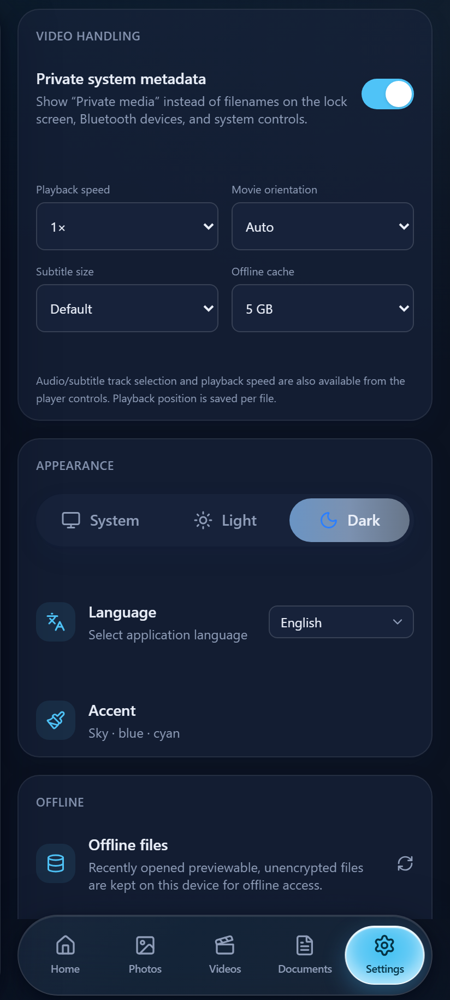

<p align="center">
  
</p>

<p align="center">
  <a href="https://github.com/hellocloudwebdev/shelf-drive-mobile/releases/latest"></a>
  <a href="https://github.com/hellocloudwebdev/shelf-drive-mobile/actions/workflows/quality-assurance.yml"></a>
</p>

<p align="center">
  
  
  
  
  
  
  
  
</p>

<p align="center">
  
</p>

<p align="center">
  <strong><em>“More than storage — it’s your digital shelf.”</em></strong>
</p>

<p align="center">
  A local-first file workspace for Android, built on the files already in your Telegram account.<br>
  Folders, search, streaming, sync, transfers and optional encryption — no relay servers, no telemetry by default.
</p>

<p align="center">
  <a href="https://github.com/hellocloudwebdev/shelf-drive-mobile/releases/latest"></a>
  &nbsp;
  <a href="https://hellocloudwebdev.github.io/shelf-drive-mobile/"></a>
</p>

<p align="center">
  <sub><b>App tour</b> · <b>Features</b> · <b>Screens</b> · <b>Download</b> · <b>Privacy</b> · <b>Quick start</b> · <b>Build</b> · <b>Tech</b> — <a href="#app-tour">jump to App tour ↓</a></sub>
</p>

<br>

> **Repository scope:** this repository builds the **Android** application — phones, tablets, Android TV and Google TV. The Windows, macOS and Linux builds live in the sibling repository [`hellocloudwebdev/shelf-drive`](https://github.com/hellocloudwebdev/shelf-drive). The application core (`app/src`, `app/src-tauri/src`, tests and dependency manifests) is shared between the two repositories and kept in sync — see [Docs/SHARED_CORE_SYNC.md](./Docs/SHARED_CORE_SYNC.md).

> **Android compatibility:** Android 12–16 (API 31–36), `minSdk` 31 and `targetSdk` 36. Version 4.4.8 dropped support for Android 7–11.

---

<a id="app-tour"></a>

<h2 align="center">App tour</h2>

<p align="center">
  
</p>

<p align="center">
  <sub>Captured from the running app — the same screenshots in this README are regenerated by <code>scripts/capture-readme-screenshots.mjs</code>.</sub>
</p>

<p align="center">
  
</p>

---

## The idea

> *“Your Saved Messages become your personal storage. Shelf Drive turns it into a clean, organized drive for all your files.”*
>
> — Shelf Drive onboarding tour

Telegram gives every account generous cloud storage through Saved Messages and channels. Shelf Drive turns that raw storage into a real file workspace: folders that map to private channels, saved views, search, streaming, durable transfers, sharing and optional encryption — all running on your device, with no relay server in between.

Think of it as a personal cloud drive where **the storage is yours, the app is open source, and the data path is direct**: device → Telegram.

---

## Features

| Feature | What it does |
|:---|:---|
| **File management** | Touch-first grid and list views, multi-select, bulk actions, rename, move, delete, folders and instant search |
| **Folders as channels** | Every folder is a private Telegram channel, so organization survives reinstalls and stays in sync with the desktop app |
| **Transfers** | Durable upload and download queues that survive restarts, with pause, resume, retry and bandwidth controls |
| **Media streaming** | Built-in video and audio playback, image viewer, Continue Watching shelf |
| **Documents** | PDF viewer, archive browsing (ZIP/RAR/7z), and a documents tab that collects everything in one place |
| **Folder sync** | Two-way sync between a local directory and a Telegram channel — see [SYNC_GUIDE.md](./SYNC_GUIDE.md) |
| **Sharing** | Password-protected download links, QR codes and Telegram message links |
| **Encryption** | Optional TDENC2 envelope encryption with a vault passphrase, per-file passphrases and recovery bundles |
| **Offline packs** | Keep a folder on the device so it stays browsable and playable without a connection |
| **Storage insights** | Large-file and duplicate detection, weekly usage telemetry against your Telegram limits |
| **15 themes** | Dark, light, AMOLED, Nord, Monokai, Ocean, Forest, Plum, Paper, Rose, Mint, Sky and more |
| **24 languages** | English, Spanish, Russian, Arabic, Hindi, Bengali, Chinese, Japanese, Korean, Persian, Urdu and more, with RTL support |
| **TV navigation** | Spatial navigation and remote-control focus handling for Android TV and Google TV |
| **Accessibility** | WCAG 4.5:1 contrast enforcement, reduced motion, screen-reader tested controls |

<details>
<summary><strong>Why the mobile shell feels different</strong></summary>
<br>

A five-tab bottom bar (Home · Photos · Videos · Documents · Settings) keeps the most-used surfaces one thumb away, while a frosted drawer mirrors the desktop sidebar for everything else. The floating upload button opens one sheet that covers files, photos, videos, whole folders and the Android document picker.

<sub>The shell is deliberately shallow: every screen is reachable in two taps, and the transfer indicator stays visible while you browse.</sub>

</details>

---

## Screens

<p align="center">
  
  &nbsp;&nbsp;
  
  &nbsp;&nbsp;
  
</p>

<p align="center">
  <em>Home dashboard with instant search · Channel-backed folder · Photo gallery</em>
</p>

<p align="center">
  
  &nbsp;&nbsp;
  
  &nbsp;&nbsp;
  
</p>

<p align="center">
  <em>Video library · Documents and vault files · Frosted navigation drawer</em>
</p>

<h3 align="center">Dark and light</h3>

<p align="center">
  
  &nbsp;&nbsp;
  
  &nbsp;&nbsp;
  
</p>

<p align="center">
  <em>15 built-in palettes with system-preference sync; every palette enforces a 4.5:1 contrast floor</em>
</p>

<details>
<summary><strong>More screens — onboarding, file actions, uploads and appearance</strong></summary>
<br>

| First run | Guided tour | File actions |
|:---:|:---:|:---:|
|  |  |  |

| Upload sheet | Appearance | Settings |
|:---:|:---:|:---:|
|  |  |  |

<p align="center">
  <sub>Every image is a real render of the mobile runtime in a browser harness with mocked Tauri IPC — no mockups.</sub>
</p>

</details>

<br>

### Regenerating the screenshots

```bash
# Terminal 1 — dev server
cd app && npm run dev -- --host 127.0.0.1 --port 4173

# Terminal 2 — capture into screenshots/live/
node scripts/capture-readme-screenshots.mjs

# Optional — rebuild the GIF tour and the website's WebP copies
python scripts/generate_readme_assets.py
python scripts/generate_website_assets.py
```

---

## Download

Shelf Drive for Android ships as a **signed, sideloaded APK** — not through Google Play.

| Platform | Artifact | Notes |
|:---|:---|:---|
| **Android phone / tablet** | [Latest release](https://github.com/hellocloudwebdev/shelf-drive-mobile/releases/latest) | Android 12–16 (API 31–36), universal APK |
| **Android TV / Google TV** | Same APK | Remote-control navigation, focus ring handling |

### Sideload install

1. Download `ShelfDrive_<version>.apk` from the [latest release](https://github.com/hellocloudwebdev/shelf-drive-mobile/releases/latest).
2. Open the file and accept the **install from unknown sources** prompt for your browser or file manager.
3. Launch Shelf Drive and sign in with your Telegram API credentials.

Release APKs are signed with a pinned release keystore and verified in CI before publication. The runbook — including the certificate fingerprint and manual verification steps — is in [Docs/ANDROID_SIDELOAD_RELEASE.md](./Docs/ANDROID_SIDELOAD_RELEASE.md).

### In-app updates

The app fetches a **minisign-signed update manifest** (`android-update.json` + `.sig`) from this repository's releases, verifies the signature against a public key embedded in the app, checks the downloaded APK's SHA-256 digest, and only then hands the file to Android's package installer.

---

## Privacy and security

> *“Private folders, built in. Shelf Drive uses private Telegram channels to keep your folders organized and accessible only to you.”*
>
> — Shelf Drive onboarding tour

- **No relay servers.** Files travel directly between your device and Telegram over MTProto. No Shelf Drive infrastructure sits in the data path.
- **Credentials stay local.** Your API ID and hash live in the Android Keystore-backed secure store and are never uploaded to a Shelf Drive service.
- **Encryption is explicit.** TDENC2 envelope encryption adds a vault passphrase on top of Telegram's transport encryption; recovery bundles are yours to export and store.
- **Encrypted streaming.** TDENC2-protected audio, video and PDF content can stream without being written to disk in the clear.
- **Signed updates.** Release artifacts are signed, and the sideload manifest is minisign-verified with a key embedded in the app.
- **No analytics by default.** Crash reporting is opt-in only, behind a consent dialog on first launch.
- **Open source.** The Rust backend, React frontend and every IPC boundary are auditable.

Full detail: [PRIVACY.md](./PRIVACY.md) · [SECURITY.md](./SECURITY.md)

---

## Quick start

1. Install the APK from the [latest release](https://github.com/hellocloudwebdev/shelf-drive-mobile/releases/latest).
2. Create a free Telegram API ID at [my.telegram.org](https://my.telegram.org) → **API development tools**.
3. Enter your **API ID** and **API hash** on the welcome screen.
4. Sign in with your Telegram account (phone number + login code).
5. Your Saved Messages files appear immediately — private channels become folders.

> **Tip:** the first launch shows a short tour explaining how Telegram storage becomes an organized drive. You can skip it and reopen it from **Help & FAQ** at any time.

---

## Build from source

### Prerequisites

| Requirement | Version / notes |
|:---|:---|
| [Node.js](https://nodejs.org/) | v20 or newer |
| [Rust](https://www.rust-lang.org/tools/install) | stable, with Android targets: `aarch64-linux-android`, `armv7-linux-androideabi`, `i686-linux-android`, `x86_64-linux-android` |
| Android SDK + NDK | NDK r30 (`30.0.14904198`) with `NDK_HOME` / `ANDROID_NDK_HOME` exported |
| JDK | 17 |
| Git | any recent version |

```bash
# Clone and enter the app folder
git clone https://github.com/hellocloudwebdev/shelf-drive-mobile.git
cd shelf-drive-mobile/app

# Install frontend dependencies
npm install

# Generate the Android project (idempotent)
npm run tauri android init

# Run on a device or emulator with hot reload
npm run tauri android dev

# Build a signed release APK + AAB for all four architectures
npm run tauri android build -- --target aarch64 armv7 i686 x86_64 --apk true --aab true --ci
```

`app/scripts/package-android-release.sh` packages the APK/AAB pair, the SHA-256 manifest and the signed `android-update.json` consumed by the in-app updater.

### Verification gates

```bash
cd app
npm run test              # unit tests
npm run build:verify      # build + bundle budget check
npm run i18n:check        # locale validation

cd src-tauri
cargo check               # Rust library
cargo check --target aarch64-linux-android
```

---

## Release flow

Releases are tag-driven. Pushing a `v*` tag runs [`.github/workflows/release.yml`](./.github/workflows/release.yml), which

1. runs the verification gates (frontend tests, build, Rust tests, clippy, i18n),
2. calls [`android.yml`](./.github/workflows/android.yml) to build and sign the APK/AAB for all four Android architectures and exercise the emulator suite,
3. validates and attaches the signed artifacts to a draft release,
4. generates the source SBOM, checksums and sigstore provenance attestations,
5. publishes only after every gate passes.

The landing site in [`website/`](./website) is published separately by [`.github/workflows/pages.yml`](./.github/workflows/pages.yml).

---

## Tech stack

| Layer | Technology | Purpose |
|:---|:---|:---|
| **Frontend** | React 19, TypeScript 5.8, Tailwind CSS 4 | UI components and styling |
| **Animation** | Framer Motion | Transitions and gesture-driven interactions |
| **State** | TanStack Query, React Context | Server state and app state |
| **Bundler** | Vite 7 | Fast builds and HMR |
| **Mobile framework** | Tauri 2 (Android) | Native Android container for the web frontend |
| **Backend** | Rust (Tokio) | Local services, transfers and file operations |
| **Telegram** | Grammers (MTProto) | Direct Telegram API communication |
| **Database** | SQLite | File metadata and workspace state |
| **Encryption** | XChaCha20-Poly1305 + Argon2 | Optional TDENC2 file encryption |
| **i18n** | i18next | 24 locales, RTL aware |
| **Testing** | Vitest, Testing Library, emulator suite | Unit, integration and on-device tests |
| **Website** | Hand-written HTML/CSS/JS | Static landing page, no build step |

---

## Documentation

| Document | Description |
|:---|:---|
| [Android sideload guide](./Docs/ANDROID_SIDELOAD_RELEASE.md) | Install without Play Store; signing and CI secrets |
| [Shared core sync](./Docs/SHARED_CORE_SYNC.md) | How shared code stays in sync with the desktop repository |
| [Architecture freeze](./Docs/ARCHITECTURE_FREEZE.md) | Architecture invariants and review notes |
| [Cross-platform migration audit](./Docs/CROSS_PLATFORM_MIGRATION_AUDIT.md) | Platform-by-platform state of the migration |
| [Repository split plan](./Docs/REPOSITORY_SPLIT_PLAN.md) | How the mobile and desktop repositories divide work |
| [Sync guide](./SYNC_GUIDE.md) | Configuring bidirectional folder sync |
| [Privacy policy](./PRIVACY.md) | What is and is not collected |
| [Security policy](./SECURITY.md) | Vulnerability reporting and threat model |
| [Changelog](./CHANGELOG.md) | Version history and release notes |

---

## Contributing

Contributions are welcome — issues, fixes, translations and documentation.

1. Fork the repository and create a branch.
2. Make the change and run the verification gates above.
3. Open a pull request describing the behaviour you changed and how you verified it.

Please keep the shared core (`app/src`, `app/src-tauri/src`) free of Android-only assumptions; the same code ships in the desktop repository.

---

## iOS status

**iOS is not production-ready and no iOS builds or release claims are made.**

What exists: Rust `#[cfg]` gates in the shared core exclude desktop-only dependencies from iOS targets, `deny.toml` covers the iOS targets, and an `app/src-tauri/icons/ios/` asset set is in the tree.

What does not exist: Xcode project generation, a CI pipeline, capability/entitlement validation, signing infrastructure or any tested device build. Building for iOS additionally requires macOS with Xcode.

---

## Licensing status

This repository currently has **no `LICENSE` file**, and GitHub reports no declared license. Confirm the applicable terms with the maintainer before reusing or redistributing this code.

---

<p align="center">
  <strong>Shelf Drive</strong><br>
  <em>More than storage — it’s your digital shelf.</em>
</p>

<p align="center">
  <sub>
    Built by <a href="https://github.com/hellocloudwebdev">hellocloudwebdev</a><br>
    <a href="https://github.com/hellocloudwebdev/shelf-drive-mobile/releases">Releases</a> ·
    <a href="https://github.com/hellocloudwebdev/shelf-drive-mobile/issues">Issues</a> ·
    <a href="https://hellocloudwebdev.github.io/shelf-drive-mobile/">Website</a> ·
    <a href="https://github.com/hellocloudwebdev/shelf-drive">Desktop repository</a>
  </sub>
</p>

<p align="center">
  <sub>
    <em>“Telegram becomes your cloud. Shelf Drive turns it into a clean, organized drive for all your files.”</em><br>
    <em>“Photos, videos, documents, and more — organized, searchable, and available wherever you use Shelf Drive.”</em>
  </sub>
</p>
