<p align="center">
  
</p>

<p align="center">
  <a href="https://github.com/hellocloudwebdev/shelf-drive-mobile/releases/latest"></a>
  <a href="https://github.com/hellocloudwebdev/shelf-drive-mobile/actions/workflows/quality-assurance.yml"></a>
  <a href="https://github.com/hellocloudwebdev/shelf-drive-mobile/releases"></a>
</p>

<p align="center">
  
  
  
  
  
  
  
  
  
</p>

<p align="center">
  
</p>

<p align="center">
  <strong><em>“More than storage — it’s your digital shelf.”</em></strong>
</p>

<p align="center">
  A local-first, privacy-respecting file workspace for Android, built directly on the files in your Telegram account.<br>
  Channel-backed folders, instant search, on-the-fly streaming, background sync, durable transfers, and optional TDENC2 encryption — zero relay servers, no telemetry by default.
</p>

<p align="center">
  <a href="https://github.com/hellocloudwebdev/shelf-drive-mobile/releases/latest"></a>
  &nbsp;
  <a href="https://hellocloudwebdev.github.io/shelf-drive-mobile/"></a>
  &nbsp;
  <a href="#app-tour"></a>
</p>

<p align="center">
  <sub><b><a href="#app-tour">01 App Tour</a></b> · <b><a href="#features">02 Features</a></b> · <b><a href="#screens">03 Dark &amp; Light UI</a></b> · <b><a href="#download">04 Download</a></b> · <b><a href="#privacy">05 Privacy &amp; Security</a></b> · <b><a href="#quick-start">06 Quick Start</a></b> · <b><a href="#tech-stack">07 Architecture &amp; Tech</a></b></sub>
</p>

<br>

> [!NOTE]
> **Repository Scope:** This repository builds the **Android** application — phones, tablets, foldable devices, Android TV, and Google TV. Desktop builds for Windows, macOS, and Linux live in the sibling repository [`hellocloudwebdev/shelf-drive`](https://github.com/hellocloudwebdev/shelf-drive). The application core (`app/src`, `app/src-tauri/src`, tests, and dependency policies) is shared and kept in strict synchronization — see [Docs/SHARED_CORE_SYNC.md](./Docs/SHARED_CORE_SYNC.md).

> [!IMPORTANT]
> **Android Baseline:** Android 12–16 (API 31–36), `minSdk` 31, and `targetSdk` 36. Version 4.4.8+ deprecated legacy Android 7–11 support to leverage Android 12+ native Keystore isolation, WorkManager background guarantees, and Modern WebView engine standards.

---

<a id="app-tour"></a>

<p align="center">
  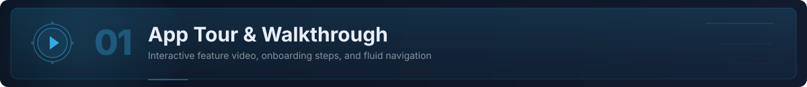
</p>

<h3 align="center">Feature Video: Onboarding &amp; Drive Concept Tour</h3>

<p align="center">
  <video src="./assets/readme/tour-feature.mp4" controls="controls" width="100%" poster="./screenshots/live/02-tour-cloud.png" style="max-width: 960px; border-radius: 12px; box-shadow: 0 16px 36px rgba(0,0,0,0.45);"></video>
</p>

<p align="center">
  <a href="./assets/readme/tour-feature.mp4">
    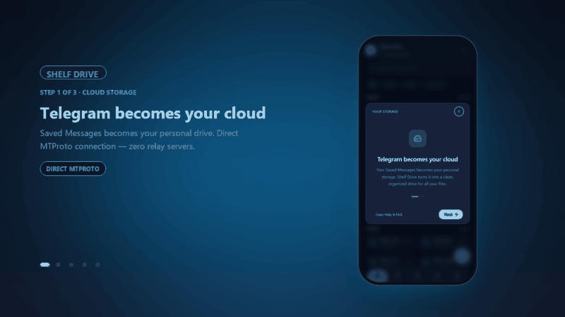
  </a>
</p>

<p align="center">
  <sub>🎥 <b>High-Definition Walkthrough:</b> <a href="./assets/readme/tour-feature.mp4"><b>Download MP4 (764 KB)</b></a> · <a href="./assets/readme/showcase.mp4"><b>Showcase Tour MP4 (1.89 MB)</b></a> · Generated directly from live mobile render runs</sub>
</p>

<br>

<h3 align="center">Interactive Showcase Carousel</h3>

<p align="center">
  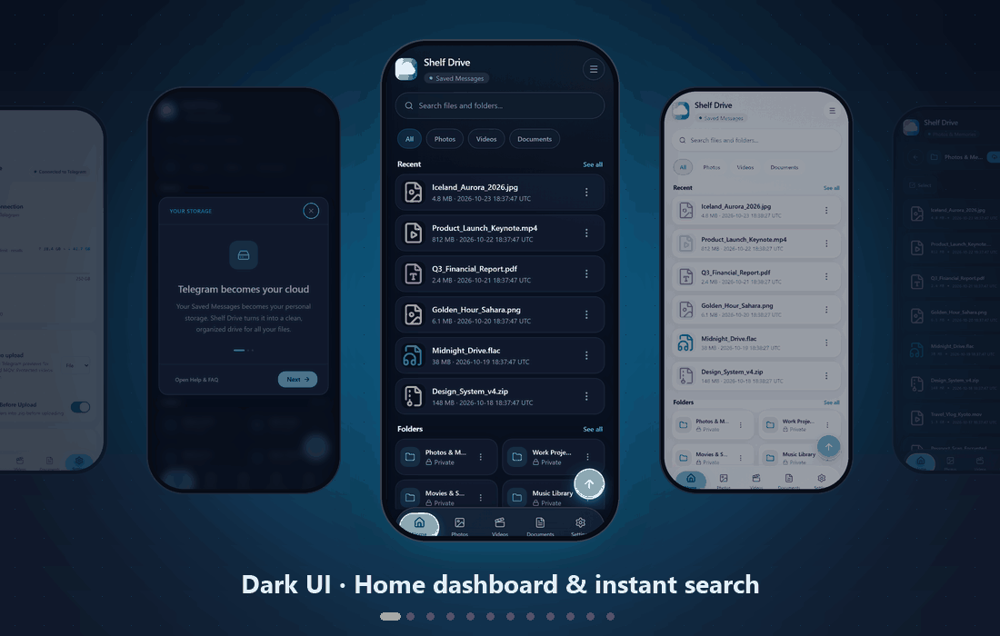
</p>

<p align="center">
  <sub>Captured from the running Android runtime with mocked Tauri IPC — regenerated deterministically via <code>scripts/generate_readme_assets.py</code></sub>
</p>

<p align="center">
  
</p>

<br>

### The Drive Concept: 3 Steps to Your Personal Cloud

> *“Your Saved Messages becomes your personal storage. Shelf Drive turns it into a clean, organized drive for all your files.”*
>
> — *Shelf Drive Guided Onboarding Tour*

Telegram provides every account with virtually unlimited cloud storage through **Saved Messages** and private channels. Shelf Drive bridges the gap between raw messaging chats and a full-fledged cloud workspace:

1. **Step 1: Storage (Telegram Becomes Your Cloud)**  
   Your Saved Messages chat becomes your primary home drive. Files sent here are indexed locally into photos, videos, audio, and documents with instant retrieval.
2. **Step 2: Folders (Private Channels, Built In)**  
   Every folder you create is mapped to an isolated, private Telegram channel. Folders survive complete app reinstalls, cannot be viewed by other users, and stay in continuous sync with the desktop application.
3. **Step 3: Files (Everything In One Place)**  
   High-speed thumbnail grids, metadata extractors, multi-part parallel resumable streaming, and optional TDENC2 client-side envelope encryption.

---

<a id="features"></a>

<p align="center">
  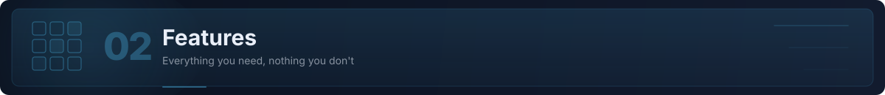
</p>

| Feature | Capabilities &amp; Mobile Specifics |
|:---|:---|
| **Touch-First File Management** | Adaptive grid and list layouts, gesture multi-select, drag-and-drop batch operations, instant search, and unified breadcrumbs. |
| **Folders as Private Channels** | Zero server setup. Each folder is a private Telegram channel. Moving or renaming files preserves channel mapping and syncs across devices. |
| **Durable Transfer Engine** | Background `WorkManager` upload and download queues that survive device restarts and network transitions with pause, resume, and auto-retry. |
| **Instant Media Streaming** | In-app playback for 4K/1080p video (HLS / MP4 / MKV) and lossless audio (FLAC / MP3 / AAC / OGG). Continues playback where you left off. |
| **Documents &amp; Archives** | Integrated PDF reader, rich document filters, and in-memory ZIP/RAR/7z archive exploration with selective file extraction. |
| **Bidirectional Folder Sync** | Continuous or scheduled background synchronization between local Android storage folders and Telegram channels — see [SYNC_GUIDE.md](./SYNC_GUIDE.md). |
| **TDENC2 Envelope Encryption** | Optional client-side XChaCha20-Poly1305 + Argon2id encryption. Vault passphrase never leaves the device. Supports encrypted streaming. |
| **Country Code Picker &amp; QR Sign-In** | High-reliability sign-in flow with searchable country code prefix selector, DC auto-migration, and direct QR code authentication. |
| **Offline Packs** | Pin any folder or file to local device cache for uninterrupted offline browsing and playback on flights and low-connectivity zones. |
| **15 Liquid Themes** | Dark, Light, Pure AMOLED, Nord, Monokai, Ocean, Forest, Plum, Paper, Rose, Mint, Sky, etc., with automatic system dark/light synchronization. |
| **24 Languages &amp; Full RTL** | English, Spanish, Russian, Arabic, Hindi, Bengali, Chinese, Japanese, Korean, Persian, Urdu, French, German, and more, with native RTL layout mirroring. |
| **TV &amp; Remote Navigation** | Tailored D-pad spatial navigation, remote focus rings, and large-screen dashboard mode for Android TV and Google TV. |
| **Privacy-Safe Local Diagnostics** | Bounded, rotating local diagnostic logs on API 31+. In-app log reviewer, copy, and export tools. Zero automated telemetry or analytics. |
| **Viewport Zoom Guard** | Enforces a stable, non-scalable viewport and native gesture guards on Android phones to eliminate accidental pinch-zoom jitter. |

<details>
<summary><strong>📱 Mobile Shell Architecture: Designed for One-Thumb Ergonomics</strong></summary>
<br>

- **Shallow Navigation Hierarchy:** A persistent 5-tab bottom navigation bar (`Home` · `Photos` · `Videos` · `Documents` · `Settings`) brings all major media domains within immediate reach.
- **Frosted Drawer:** Swiping from the left opens the acrylic frosted drawer with custom folder workspaces, storage insights, shared views, and channel settings.
- **Multi-Type Upload Sheet:** A unified floating action trigger opens a multi-source sheet covering individual files, camera photos, video rolls, folder trees, and the native Android Document Provider.
- **Persistent Transfer Status:** Real-time transfer pill stays docked at the bottom of the screen while navigating, keeping upload/download speeds and queue depths visible.

</details>

---

<a id="screens"></a>

<p align="center">
  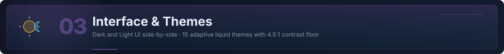
</p>

### Side-by-Side: Dark UI vs. Light UI

Every screen in Shelf Drive is crafted in both dark and light palettes, adhering to a strict **4.5:1 WCAG contrast floor** for accessibility, outdoor sunlight readability, and night-time eye comfort:

| Screen Surface | Dark Mode | Light Mode |
|:---:|:---:|:---:|
| **Home Dashboard**<br><sub>Recent items, storage overview, instant search</sub> | 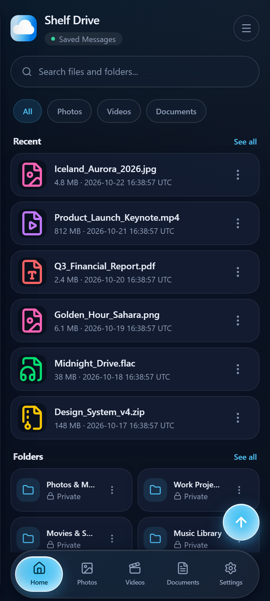 | 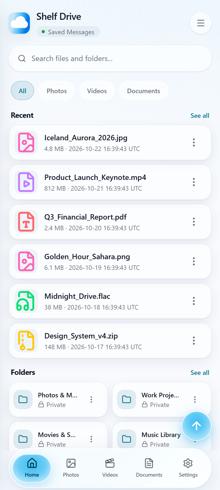 |
| **Photos &amp; Memories Folder**<br><sub>Channel-backed workspace with upload controls</sub> | 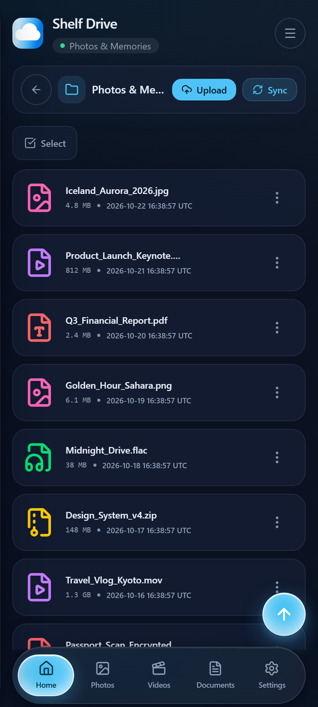 | 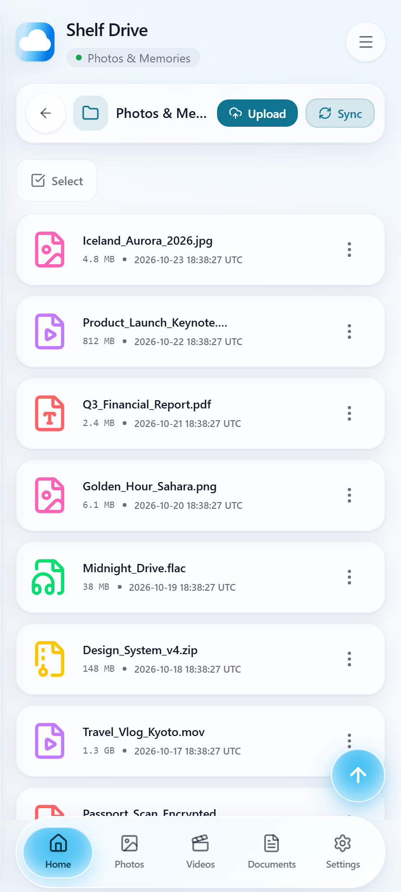 |
| **Photo Gallery Grid**<br><sub>Vibrant thumbnail tiles &amp; album grouping</sub> | 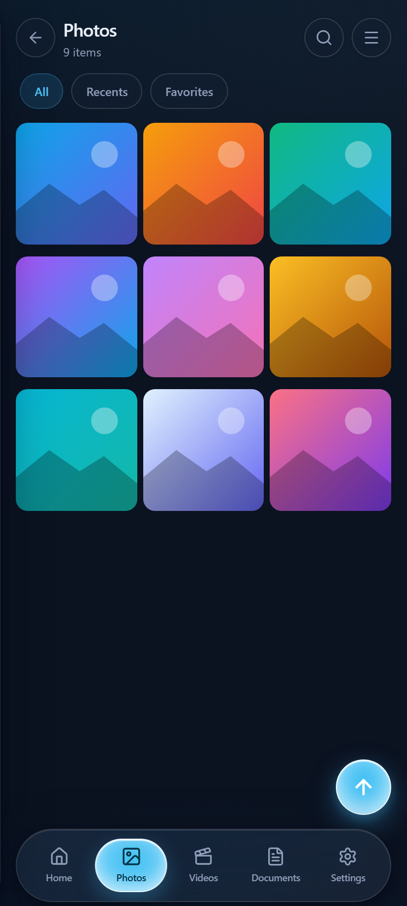 | 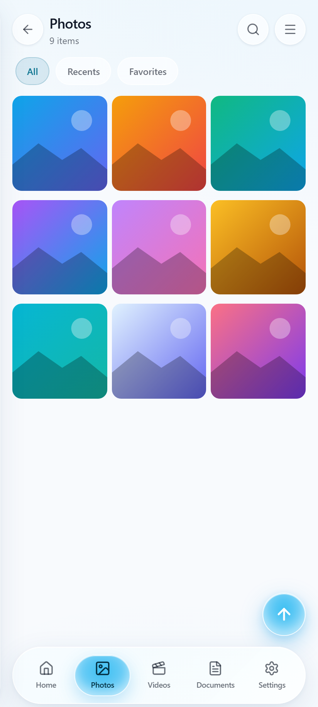 |
| **Documents Workspace**<br><sub>PDFs, spreadsheets, encrypted vault records</sub> | 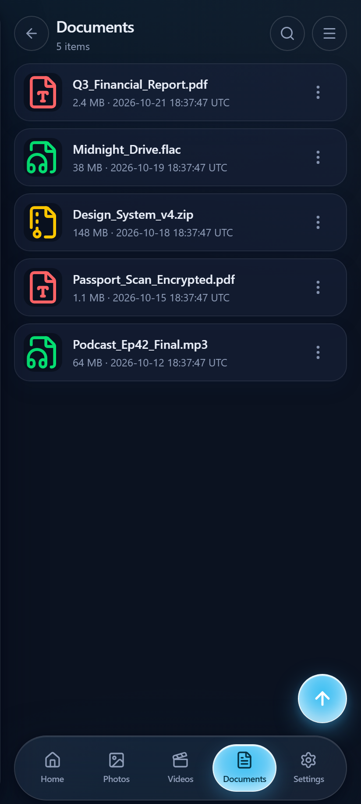 | 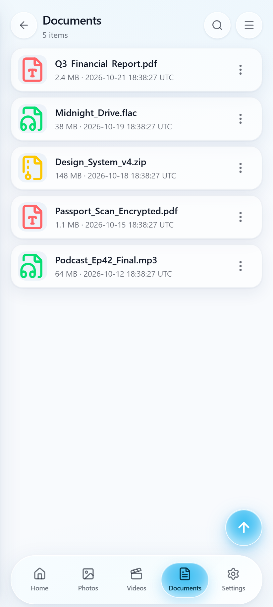 |
| **Settings &amp; Telemetry**<br><sub>Network limits, 15 themes, diagnostic tools</sub> | 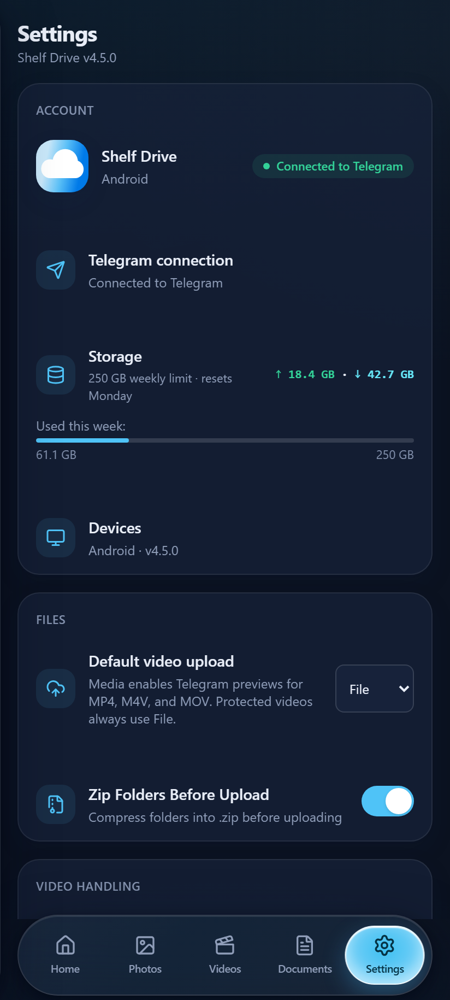 | 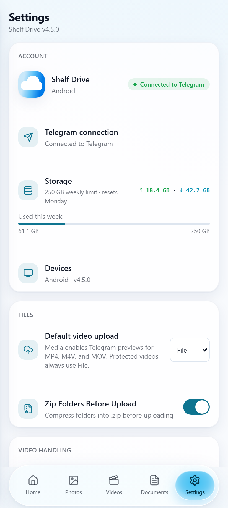 |

<br>

### Guided Onboarding &amp; Mobile Interaction Sheets

| 01. Welcome &amp; Auth | 02. Guided Tour Step 1 | 03. Guided Tour Step 2 |
|:---:|:---:|:---:|
| 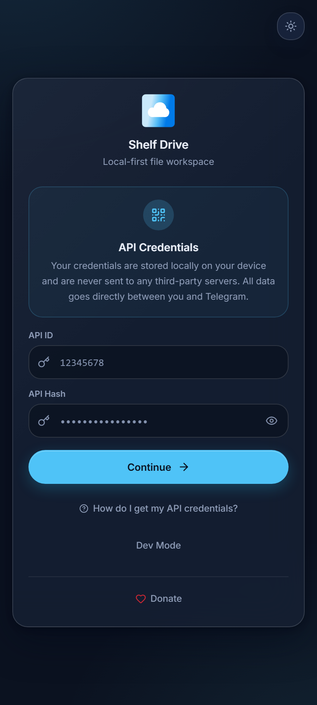 | 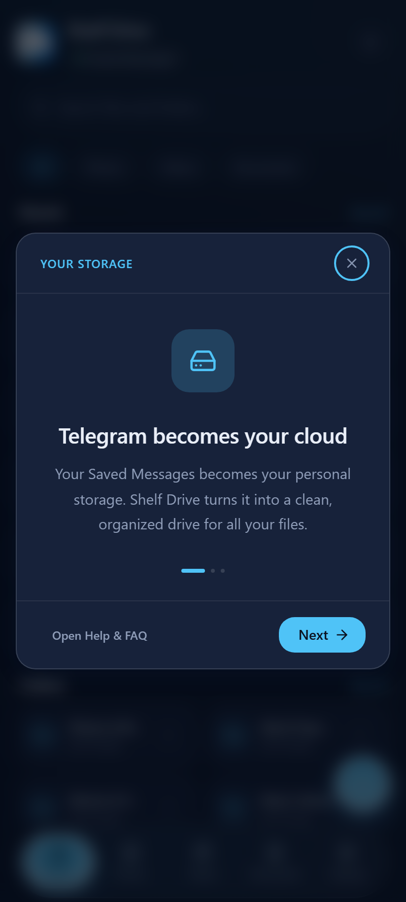 | 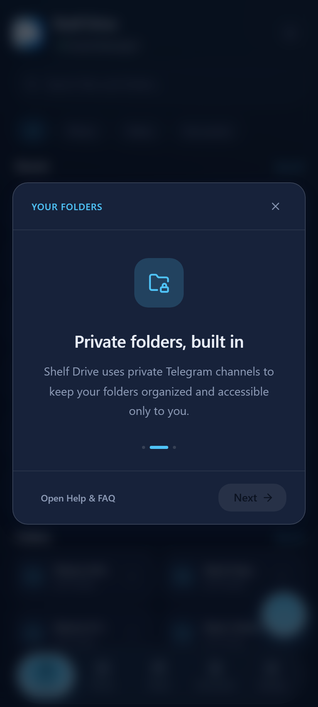 |
| <sub>Telegram credentials &amp; country selector</sub> | <sub>Your Saved Messages as cloud storage</sub> | <sub>Private channels as permanent folders</sub> |

| 04. Video Library | 05. Navigation Drawer | 06. Contextual File Actions | 07. Multi-Source Upload |
|:---:|:---:|:---:|:---:|
| 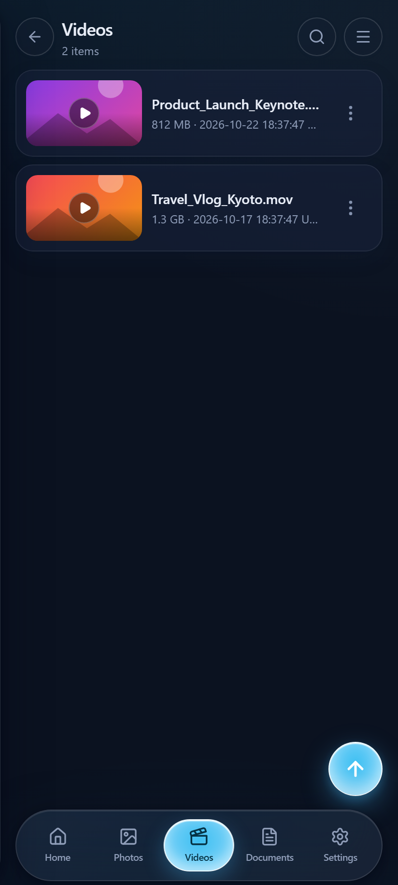 | 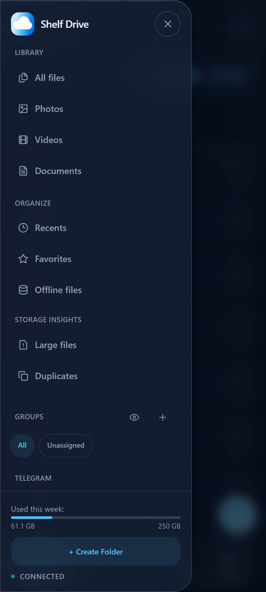 | 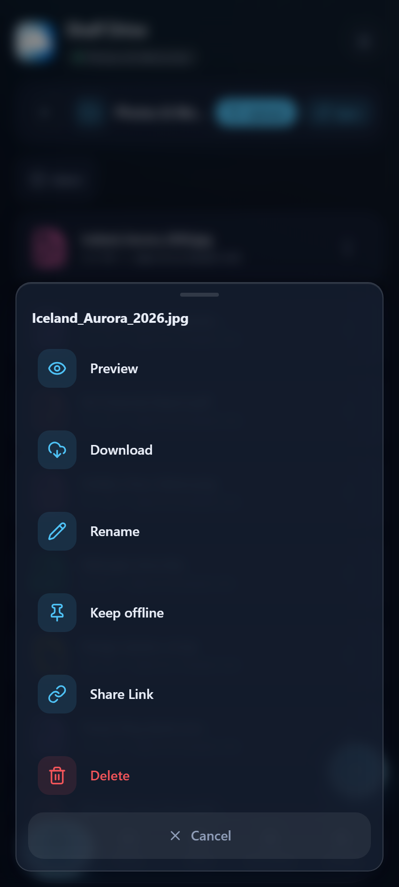 | 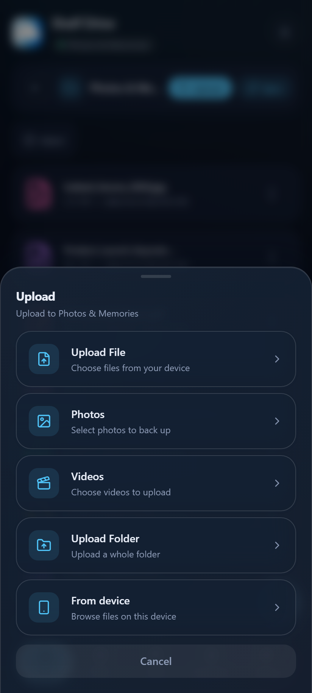 |
| <sub>Media streaming &amp; offline playback</sub> | <sub>Folder channels &amp; quick filters</sub> | <sub>Download, rename, pin, share, vault</sub> | <sub>Files, photos, videos &amp; directories</sub> |

<br>

<details>
<summary><strong>🛠️ How to Regenerate Live Screenshots &amp; Media Assets</strong></summary>
<br>

Screenshots and videos are 100% reproducible and generated by headless automated browser scripts:

```bash
# Terminal 1 — Start the mobile preview server
cd app && npm run dev -- --host 127.0.0.1 --port 4173

# Terminal 2 — Capture high-res screenshots (both Dark & Light modes)
node scripts/capture-readme-screenshots.mjs

# Terminal 3 — Rebuild the animated tour video, showcase GIF, and website WebP assets
python scripts/generate_tour_video.py
python scripts/generate_readme_assets.py
python scripts/generate_website_assets.py
```

</details>

---

<a id="download"></a>

<p align="center">
  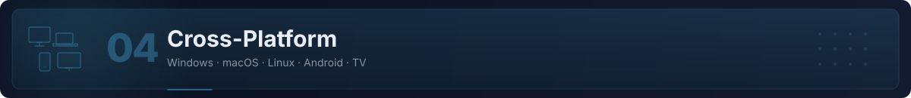
</p>

Shelf Drive for Android is distributed as an **independently signed, sideloaded release** — free from Google Play restrictions and relay dependencies.

| Platform / Form Factor | Artifact | Architecture &amp; Target |
|:---|:---|:---|
| **Android Phones &amp; Foldables** | [Latest Release APK](https://github.com/hellocloudwebdev/shelf-drive-mobile/releases/latest) | Universal APK (API 31–36: `arm64-v8a`, `armeabi-v7a`, `x86`, `x86_64`) |
| **Android Tablets** | [Latest Release APK](https://github.com/hellocloudwebdev/shelf-drive-mobile/releases/latest) | Adaptive multi-column split view layout |
| **Android TV &amp; Google TV** | Same Universal APK | Dedicated TV banner, D-pad remote focus rings, leanback controls |
| **Play App Signing Bundle** | [Latest Release AAB](https://github.com/hellocloudwebdev/shelf-drive-mobile/releases/latest) | `ShelfDrive_<version>.aab` for custom distribution |

### Sideload Installation Runbook

1. Download `ShelfDrive_<version>.apk` from [GitHub Releases](https://github.com/hellocloudwebdev/shelf-drive-mobile/releases/latest).
2. Tap the downloaded file and confirm the **Install from unknown sources** prompt in your browser or file manager.
3. Open Shelf Drive and connect your Telegram account.

### Cryptographic In-App Updates

The application checks for new releases by fetching a **minisign-signed manifest** (`android-update.json` + `android-update.json.sig`). Before passing the package to Android’s Package Installer, Shelf Drive:
- Verifies the cryptographic signature against the embedded maintainer public key.
- Validates the downloaded APK’s SHA-256 hash against the manifest.
- Ensures the package signature matches the pinned release keystore.

Detailed release procedures and certificate fingerprints: [Docs/ANDROID_SIDELOAD_RELEASE.md](./Docs/ANDROID_SIDELOAD_RELEASE.md).

---

<a id="privacy"></a>

<p align="center">
  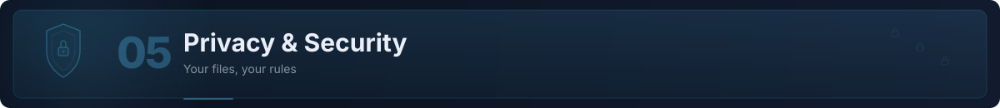
</p>

> *“Private folders, built in. Shelf Drive uses private Telegram channels to keep your folders organized and accessible only to you.”*
>
> — *Shelf Drive Security Invariants*

- 🛡️ **Zero Relay Infrastructure:** Files travel directly between your Android device and Telegram servers over encrypted MTProto. Shelf Drive operates no relay servers, proxies, or storage nodes.
- 🔑 **Hardware-Backed Keystore:** API credentials, session tokens, and master keys reside in the Android Keystore secure enclave.
- 🔒 **TDENC2 Envelope Encryption:** Client-side XChaCha20-Poly1305 authenticated encryption with Argon2id key derivation adds military-grade confidentiality before files leave your phone.
- 🎬 **Zero-Disk Encrypted Streaming:** TDENC2-protected audio, video, and PDF content can stream without unencrypted files being dumped into disk caches; media decrypts on-the-fly in memory.
- 📋 **Privacy-Safe Local Diagnostics:** Diagnostics are stored strictly in rotating, bounded local files on the device. Logs are never auto-uploaded. Crash reports require manual review and consent before copying to clipboard for GitHub submission.
- 🚫 **No Tracking, No Telemetry:** No third-party ad SDKs, tracker pixels, or behavioral analytics libraries are compiled into the binary.

Full policies: [PRIVACY.md](./PRIVACY.md) · [SECURITY.md](./SECURITY.md)

---

<a id="quick-start"></a>

<p align="center">
  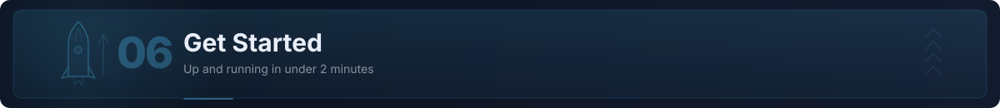
</p>

1. **Install the APK:** Download and install the latest APK from [Releases](https://github.com/hellocloudwebdev/shelf-drive-mobile/releases/latest).
2. **Obtain Telegram API Credentials:** Go to [my.telegram.org](https://my.telegram.org) → **API development tools** and create a free application ID (takes 30 seconds).
3. **Sign In:**
   - **Option A (Phone Number):** Select your country from the country code selector, type your mobile number, and enter the Telegram verification code.
   - **Option B (QR Code):** Scan the login QR code with your official Telegram mobile app (**Settings** → **Devices** → **Link Desktop Device**).
4. **Welcome Tour:** Review the 3-step onboarding tour explaining personal cloud storage and channel folders.
5. **Start Storing:** Your Saved Messages files appear instantly. Tap the `+` button to create private channel folders and upload media!

---

<a id="tech-stack"></a>

<p align="center">
  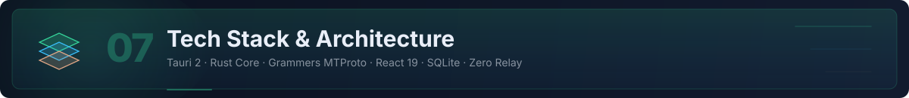
</p>

<h3 align="center">System Architecture Flow</h3>

<p align="center">
  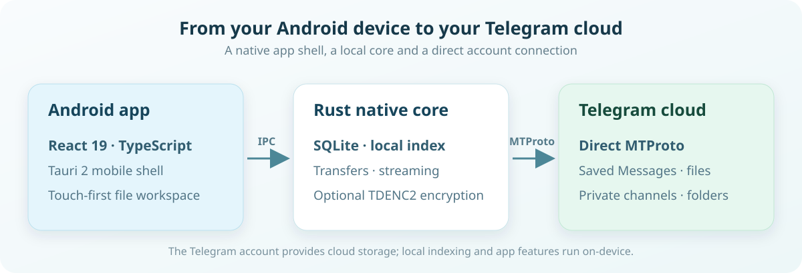
</p>

```
┌────────────────────────────────────────────────────────────────────────┐
│                        ANDROID MOBILE SHELL                            │
│  React 19  ·  TypeScript 5.8  ·  Tailwind CSS 4  ·  Framer Motion     │
│  5-Tab Navigation  ·  Frosted Drawer  ·  15 Liquid Themes  ·  24 Locales│
└───────────────────────────────────┬────────────────────────────────────┘
                                    │ Tauri 2 IPC (JNI Bridge)
┌───────────────────────────────────▼────────────────────────────────────┐
│                         RUST NATIVE CORE                               │
│  Tokio Async Runtime  ·  SQLite Local DB  ·  WorkManager Transfers     │
│  Streaming Chunk Engine  ·  TDENC2 XChaCha20-Poly1305 Cryptor          │
└───────────────────────────────────┬────────────────────────────────────┘
                                    │ Direct MTProto (Grammers)
┌───────────────────────────────────▼────────────────────────────────────┐
│                         TELEGRAM CLOUD                                 │
│  Saved Messages (Root Drive)  ·  Private Channels (Folders)            │
│  Zero Relay Servers  ·  Zero Third-Party Intermediaries                │
└────────────────────────────────────────────────────────────────────────┘
```

| Layer | Component | Description |
|:---|:---|:---|
| **Frontend Framework** | React 19.1 &amp; TypeScript 5.8 | Modern React architecture with strict type safety |
| **Mobile Runtime** | Tauri 2.11 (Android) | High-performance native WebView container powered by Rust |
| **Styling &amp; Motion** | Tailwind CSS 4 &amp; Framer Motion | Liquid-glass UI components and hardware-accelerated transitions |
| **Client State** | TanStack Query 5.90 | Optimistic updates, background caching, and reactive query invalidation |
| **Native Core** | Rust 2021 (Tokio) | Concurrent file chunking, SQLite indexing, and local streaming pipelines |
| **Telegram Protocol** | Grammers (MTProto) | Direct client-to-datacenter Telegram communications |
| **Local Database** | SQLite (libsql) | Local file index, transfer states, and folder hierarchy metadata |
| **Envelope Cryptography** | XChaCha20-Poly1305 &amp; Argon2id | TDENC2 zero-knowledge client-side file encryption |
| **Internationalization** | i18next (24 Locales) | Full coverage with RTL script mirroring and dynamic locale switching |
| **Landing Website** | Vanilla HTML5 / CSS3 / ES2024 | Ultra-fast static marketing site hosted on [GitHub Pages](https://hellocloudwebdev.github.io/shelf-drive-mobile/) |

---

## Building from Source

### Prerequisites

- **Node.js:** v20 LTS or newer
- **Rust:** Stable toolchain with Android targets:
  ```bash
  rustup target add aarch64-linux-android armv7-linux-androideabi i686-linux-android x86_64-linux-android
  ```
- **Android SDK &amp; NDK:** NDK r30 (`30.0.14904198`) with `ANDROID_HOME` and `NDK_HOME` set
- **JDK:** OpenJDK 17

### Build Commands

```bash
# Clone the repository
git clone https://github.com/hellocloudwebdev/shelf-drive-mobile.git
cd shelf-drive-mobile/app

# Install frontend packages
npm install

# Initialize the Tauri Android project (idempotent)
npm run tauri android init

# Run live on an emulator or connected device with hot reload
npm run tauri android dev

# Compile universal release APK & AAB
npm run tauri android build -- --target aarch64 armv7 i686 x86_64 --apk true --aab true --ci
```

### Quality Assurance Verification Gates

```bash
cd app
npm run test              # Unit test suite
npm run build:verify      # Typecheck, bundle compilation & budget check
npm run i18n:check        # Locale dictionary completeness & literal scan

cd src-tauri
cargo check               # Host cargo validation
cargo check --target aarch64-linux-android  # Android target validation
```

---

## Documentation Index

- 📘 [Android Sideload Release Runbook](./Docs/ANDROID_SIDELOAD_RELEASE.md) — Signing keys, manual checksum verification, and release steps.
- 🔄 [Shared Core Synchronization](./Docs/SHARED_CORE_SYNC.md) — How shared code is mirrored with the desktop repository.
- 📐 [Architecture Freeze Notes](./Docs/ARCHITECTURE_FREEZE.md) — Architectural invariants and security boundaries.
- 🗂️ [Folder Sync Guide](./SYNC_GUIDE.md) — Continuous bidirectional directory synchronization.
- 🛡️ [Privacy Policy](./PRIVACY.md) &amp; [Security Policy](./SECURITY.md) — Threat model and vulnerability disclosure.
- 📋 [Version Changelog](./CHANGELOG.md) — Release notes and comprehensive historical patch log.
- 🌐 [Marketing Website](./website/README.md) — Static documentation website and GitHub Pages publishing instructions.

---

## Contributing

Contributions are warmly welcomed! Whether you are reporting bugs, improving documentation, submitting translations, or opening pull requests:

1. Fork the repository and create your feature branch (`git checkout -b feature/amazing-feature`).
2. Run the QA verification gates above to ensure tests, bundle budgets, and linters pass.
3. Commit your changes with clear semantic commit messages (`feat: ...`, `fix: ...`, `docs: ...`).
4. Push to your branch and open a Pull Request.

*Note: Please ensure shared core components (`app/src`, `app/src-tauri/src`) maintain cross-platform compatibility with the desktop repository.*

---

<p align="center">
  <strong>Shelf Drive</strong><br>
  <em>More than storage — it’s your digital shelf.</em>
</p>

<p align="center">
  <sub>
    Crafted with care by <a href="https://github.com/hellocloudwebdev">hellocloudwebdev</a><br>
    <a href="https://github.com/hellocloudwebdev/shelf-drive-mobile/releases">Releases</a> ·
    <a href="https://github.com/hellocloudwebdev/shelf-drive-mobile/issues">Issues</a> ·
    <a href="https://hellocloudwebdev.github.io/shelf-drive-mobile/">Website</a> ·
    <a href="https://github.com/hellocloudwebdev/shelf-drive">Desktop Repository</a>
  </sub>
</p>
